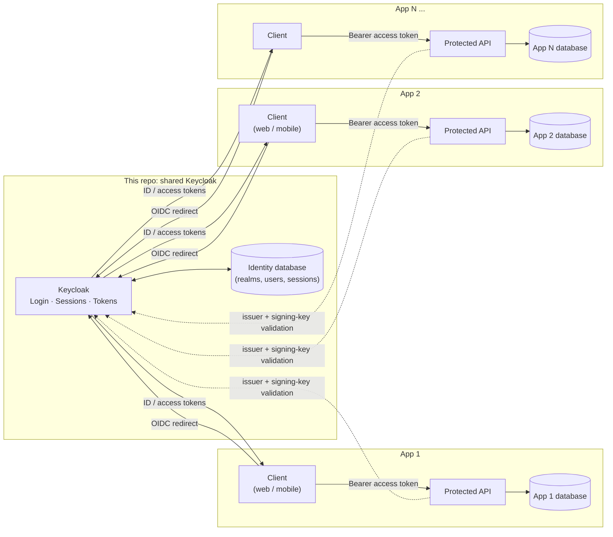

# Architecture: this Keycloak instance and the rest of BaiGanio

This is the logical relationship between this repo (a single, shared Keycloak
instance) and every other BaiGanio application: their clients, their protected
APIs, and their databases. It is environment-agnostic — the same trust shape
holds whether Keycloak is running via `DOCKER.md`, `AZURE.md`, or `K3SPI5.md`.
For the concrete deployment topology of a specific environment, see that
environment's own guide (`K3SPI5.md` has the k3s/Flux diagram, `AZURE.md` has
the Azure resource diagram).

## Trust model in one picture

## What this means for security

The threat this whole setup is designed to guard against: **unauthenticated
access to a protected API sitting in front of an app's database.** Each app's
database is never meant to be reachable directly from the public internet or
from a client — only through that app's own API, and that API's job is to
reject any request that doesn't carry a valid, non-expired, correctly-signed
token issued by this Keycloak instance for the right issuer/realm.

Concretely, each downstream app needs:

- **A client** registered in this Keycloak (public client for browser/mobile,
  confidential client for server-to-server), which redirects users here for
  login and never sees their password.
- **A protected API** that validates the bearer token's signature and issuer
  against this Keycloak's OIDC discovery document — not just checks "a token
  was present."
- **A database reachable only from that app's own API** — never exposed
  publicly, never trusting a client-supplied identity claim without the token
  behind it.

Blast radius if this instance is compromised: **every** app that trusts it,
since they all validate tokens against the same issuer. That is the reason
`Fragile / No-Touch Zones` in `AGENTS.md` treats OIDC/issuer trust config and
credential values as ask-first, not act-freely.

## What's not built yet

Per `README.md`: no realms, clients, or users are configured in any
environment yet — every scenario currently boots a bare Keycloak with only the
built-in `master` realm. The diagram above is the target trust shape;
provisioning real realms/clients per downstream app is planned, not done.
