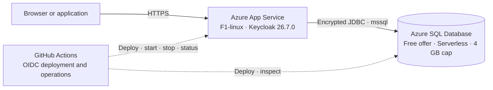

## Azure deployment

> NOTE: This example is not fully verified yet!

This deployment is a deliberately small, cost-constrained proof of concept. It
uses production-mode Keycloak and Azure SQL Database, but the F1 web app does
not provide production-grade capacity, availability, monitoring, or private
networking.

Local Docker continues to use PostgreSQL. The database vendor is selected per
environment:

```text
Local Docker: Keycloak → PostgreSQL
Azure:        Keycloak → Azure SQL Database (`KC_DB=mssql`)
```

Both databases are officially supported by Keycloak. They are independent
installations; local realms, users, and clients are not automatically copied to
Azure.

### Architecture and deliberate constraints



| Setting | Value |
| --- | --- |
| Azure region | Sweden Central (`swedencentral`) |
| Existing resource group | `keycloak` |
| Existing Linux App Service plan | `F1-linux` |
| App Service plan tier | Free F1 |
| Web app | `lk-keycloak` |
| Public URL | <https://lk-keycloak.azurewebsites.net> |
| Keycloak image | `quay.io/keycloak/keycloak:26.7.0` |
| Azure database vendor | Azure SQL Database (`mssql`) |
| Azure SQL compute | General Purpose serverless, Gen5, up to 2 vCores |
| Database maximum size | 4 GB |
| Free-limit behavior | Auto-pause for the remainder of the month; never bill overage |
| Inactivity auto-pause | After 60 idle minutes |
| Backup storage | Locally redundant, within the free-offer allowance |

The web-app and SQL logical-server names must be globally unique. Their
deterministic defaults can fail if another Azure customer already owns them.

F1 runs on shared compute, has no service-level agreement or Always On, and is
limited to 60 CPU minutes per day. Keycloak recommends more memory than F1
provides. The reduced JVM heap and small JDBC pool are reasonable experiments
for at most ten PoC users, but Keycloak may start slowly, exhaust its quota, or
fail. Other apps on `F1-linux` share those quotas.

The SQL database has a public endpoint. Its `0.0.0.0` firewall rule means
"allow Azure services"; it does not open every public internet address, but it
is broader than an app-specific private route. JDBC requires TLS and certificate
validation. The Keycloak pool starts with one connection and can grow to five.

### Understand the Azure SQL free offer

The Azure SQL free offer provides each eligible database with a monthly
allowance of 100,000 vCore seconds, 32 GB of data, and 32 GB of backup storage.
This repository deliberately caps data at 4 GB.

The template sets both safety mechanisms:

- normal inactivity: Azure SQL can auto-pause after 60 minutes with no sessions
  or user CPU, then resumes when Keycloak reconnects;
- exhausted monthly free allowance: `AutoPause` keeps the database unavailable
  for the remainder of that calendar month instead of billing an overage.

The free allowance renews at the start of the next calendar month. A paused
database can take about a minute to resume. The first connection can fail while
resume begins, so the workflows retry the public Keycloak endpoint.

The offer is subject to subscription eligibility and regional rules. Before
deploying, open **Azure SQL hub → Create SQL Database → Start free** and confirm
that the portal displays **Free offer applied** for this subscription and Sweden
Central. The Bicep deployment requests the free limit explicitly; it does not
silently fall back to a paid S0 or General Purpose database.

### Prerequisites

The operator needs:

- an Azure subscription eligible for an Azure SQL free-offer database;
- the existing `keycloak` resource group;
- the existing Linux `F1-linux` plan in Sweden Central;
- Azure CLI and resource-group deployment permission;
- permission to configure a Microsoft Entra application, service principal,
  federated credential, and role assignment;
- administrator access to the GitHub repository;
- separate strong passwords for Azure SQL and the temporary Keycloak admin.

Sign in, select the subscription, and verify the existing plan:

```bash
az login
az account list --output table
az account set --subscription "<subscription-id-or-name>"

az group show \
  --name keycloak \
  --query '{name:name, location:location, state:properties.provisioningState}'

az appservice plan show \
  --resource-group keycloak \
  --name F1-linux \
  --query '{name:name, location:location, sku:sku.name, linux:reserved}'
```

The plan must show `swedencentral`, `F1`, and `linux: true`.

### Configure password secrets

For a manual deployment, read the passwords without putting their values in the
command line:

```bash
read -s AZURE_SQL_ADMIN_PASSWORD
export AZURE_SQL_ADMIN_PASSWORD

read -s KEYCLOAK_BOOTSTRAP_ADMIN_PASSWORD
export KEYCLOAK_BOOTSTRAP_ADMIN_PASSWORD
```

The terminal deliberately displays no input. The password values must not be
committed or written into `main.bicepparam`.

### Validate and deploy manually

From the `azure/` directory in the repository:

```bash
cd azure

az bicep install
az bicep build --file main.bicep --stdout > /dev/null

az deployment group validate \
  --resource-group keycloak \
  --parameters main.bicepparam

az deployment group create \
  --name keycloak-manual \
  --resource-group keycloak \
  --parameters main.bicepparam
```

The parameter file reads `AZURE_SQL_ADMIN_PASSWORD` and
`KEYCLOAK_BOOTSTRAP_ADMIN_PASSWORD` from the environment and sends them as
secure deployment parameters. Clear them afterward:

```bash
unset AZURE_SQL_ADMIN_PASSWORD KEYCLOAK_BOOTSTRAP_ADMIN_PASSWORD
```

Inspect the outputs:

```bash
az deployment group show \
  --name keycloak-manual \
  --resource-group keycloak \
  --query properties.outputs
```

### Use the native ARM template

`azure/azuredeploy.json` is the compiled ARM JSON equivalent of `azure/main.bicep`.
This is useful with **Azure portal → Deploy a custom template**, systems that
accept ARM JSON but not Bicep, and Azure Deployment Stacks.

`main.bicep` remains the source of truth. After changing it, regenerate and
review the ARM template from the `azure/` directory:

```bash
cd azure

az bicep build \
  --file main.bicep \
  --outfile azuredeploy.json

git diff -- azuredeploy.json
```

For a fast create/destroy lifecycle, manage the resources as a deployment
stack. First load the two passwords as shown above, then validate (still from
`azure/`):

```bash
az stack group validate \
  --name keycloak-poc \
  --resource-group keycloak \
  --template-file azuredeploy.json \
  --action-on-unmanage deleteResources \
  --deny-settings-mode none \
  --parameters \
    sqlAdminPassword="$AZURE_SQL_ADMIN_PASSWORD" \
    keycloakBootstrapAdminPassword="$KEYCLOAK_BOOTSTRAP_ADMIN_PASSWORD"
```

Create or update the stack:

```bash
az stack group create \
  --name keycloak-poc \
  --resource-group keycloak \
  --template-file azuredeploy.json \
  --action-on-unmanage deleteResources \
  --deny-settings-mode none \
  --parameters \
    sqlAdminPassword="$AZURE_SQL_ADMIN_PASSWORD" \
    keycloakBootstrapAdminPassword="$KEYCLOAK_BOOTSTRAP_ADMIN_PASSWORD"

unset AZURE_SQL_ADMIN_PASSWORD KEYCLOAK_BOOTSTRAP_ADMIN_PASSWORD
```

Inspect exactly what the stack manages before destroying it:

```bash
az stack group show \
  --name keycloak-poc \
  --resource-group keycloak \
  --query '{state:provisioningState, resources:resources[].id}'
```

Destroy the stack and its managed resources:

```bash
az stack group delete \
  --name keycloak-poc \
  --resource-group keycloak \
  --action-on-unmanage deleteResources \
  --yes
```

This permanently deletes `lk-keycloak`, the generated Azure SQL logical server,
its firewall rule, and the `keycloak` database. The resource group and existing
`F1-linux` plan are references, not stack-managed resources, and remain.

Do not use `detachAll` when the intention is cleanup: it deletes only the stack
record and leaves billable resources running. The commands deliberately use
`deny-settings-mode none`, so the stack does not block normal portal or CLI
updates during the PoC.

### Configure GitHub-to-Azure OIDC

The workflows use short-lived OpenID Connect tokens rather than an Azure client
secret or App Service publish profile.

1. In **Microsoft Entra ID → App registrations**, create
   `github-keycloak-deployer`.
2. Record its **Application (client) ID** and **Directory (tenant) ID**.
3. Ensure it has a service principal in the tenant.
4. Grant that service principal **Contributor** on resource group `keycloak`.
5. Open **Certificates & secrets → Federated credentials → Add credential**.
6. Choose **GitHub Actions deploying Azure resources**.
7. Enter the GitHub owner and repository.
8. Select **Branch**, enter `master`, and create the credential. Its subject is
   `repo:<owner>/<repository>:ref:refs/heads/master`.

In **GitHub → Settings → Secrets and variables → Actions**, create:

| Secret | Value |
| --- | --- |
| `AZURE_CLIENT_ID` | Entra application client ID |
| `AZURE_TENANT_ID` | Azure tenant ID |
| `AZURE_SUBSCRIPTION_ID` | Target subscription ID |
| `AZURE_SQL_ADMIN_PASSWORD` | Strong Azure SQL administrator password |
| `KEYCLOAK_BOOTSTRAP_ADMIN_PASSWORD` | Strong temporary Keycloak password |

Restrict who can modify workflows and repository secrets. The GitHub identity
can modify resources throughout the `keycloak` resource group.

### Deploy from GitHub Actions

1. Open **GitHub → Actions → Deploy Keycloak to Azure**.
2. Run it from the `master` branch.
3. Follow the **Validate, deploy, and verify** job.

The workflow authenticates through OIDC, confirms that `F1-linux` is a free
Linux plan in Sweden Central, compiles and validates Bicep, deploys the
resources, and retries the master-realm discovery endpoint.

The first deployment creates a new Azure SQL schema. A later redeployment is
declarative and does not delete Keycloak data.

### Verify and bootstrap Keycloak

Check the public discovery endpoint:

```bash
curl --fail \
  https://lk-keycloak.azurewebsites.net/realms/master/.well-known/openid-configuration
```

Then open <https://lk-keycloak.azurewebsites.net/admin/> and sign in with:

```text
username: admin
password: the value of KEYCLOAK_BOOTSTRAP_ADMIN_PASSWORD
```

Create and verify a permanent administrator in the `master` realm, then delete
the temporary administrator. Changing the bootstrap secret later does not
change an administrator already stored in Azure SQL.

Create application users and clients in a separate realm. An application's
issuer URL is:

```text
https://lk-keycloak.azurewebsites.net/realms/<realm-name>
```

### Start, stop, and inspect the deployment

The **Operate Keycloak in Azure** workflow provides:

- `start`: starts App Service; Keycloak's first database connection triggers
  Azure SQL auto-resume, and the workflow waits up to 15 minutes;
- `stop`: stops App Service so its JDBC sessions close; Azure SQL then
  auto-pauses after 60 idle minutes;
- `status`: reports the App Service and Azure SQL states.

Azure SQL serverless does not provide a manual pause command. Stopping Keycloak
is what releases the sessions needed for automatic pause.

Equivalent CLI commands:

```bash
SQL_SERVER_NAME="$(az sql server list \
  --resource-group keycloak \
  --query "[?tags.workload == 'keycloak-poc'].name | [0]" \
  --output tsv)"

az webapp stop --resource-group keycloak --name lk-keycloak

az sql db show \
  --resource-group keycloak \
  --server "$SQL_SERVER_NAME" \
  --name keycloak \
  --query status \
  --output tsv

az webapp start --resource-group keycloak --name lk-keycloak
```

Stopping F1 does not reduce an already-zero App Service price, but it preserves
its daily CPU quota and allows Azure SQL to auto-pause.

### Cost behavior

Within the free offer, the intended Azure cost is zero for both F1 and Azure
SQL. The logical SQL server itself has no separate compute charge.

The database uses:

- at most 4 GB of the 32 GB monthly data allowance;
- locally redundant backup storage within the free allowance;
- at most 100,000 free vCore seconds per month;
- `AutoPause`, never `BillOverUsage`, when the free compute allowance ends.

This configuration prefers temporary unavailability to an unexpected database
charge. Azure pricing, taxes, subscription offers, and eligibility can change;
confirm the portal cost summary says zero before deployment and configure an
Azure budget separately.

No Log Analytics, Application Insights, Key Vault, private endpoint, NAT
gateway, paid DNS, or additional paid database service is created.

### Logs and troubleshooting

Resolve the SQL server name and show current state:

```bash
SQL_SERVER_NAME="$(az sql server list \
  --resource-group keycloak \
  --query "[?tags.workload == 'keycloak-poc'].name | [0]" \
  --output tsv)"

az webapp show \
  --resource-group keycloak \
  --name lk-keycloak \
  --query '{state:state, host:defaultHostName}'

az sql db show \
  --resource-group keycloak \
  --server "$SQL_SERVER_NAME" \
  --name keycloak \
  --query '{status:status, sku:currentServiceObjectiveName, maxSizeBytes:maxSizeBytes, freeLimit:useFreeLimit, exhaustion:freeLimitExhaustionBehavior}'
```

Enable and follow App Service container logs:

```bash
az webapp log config \
  --resource-group keycloak \
  --name lk-keycloak \
  --docker-container-logging filesystem

az webapp log tail \
  --resource-group keycloak \
  --name lk-keycloak
```

**Deployment says the free database is unavailable**

Confirm the subscription still has a free-offer allocation and that its free
database region is Sweden Central. Do not remove `useFreeLimit` merely to make
deployment succeed; that can create a paid General Purpose database.

**Azure SQL is `Paused` during ordinary inactivity**

This is expected. Start the web app and allow about a minute for the first
connection to trigger resume. App Service may retry the Keycloak container
while SQL returns transient error 40613.

**Azure SQL remains unavailable for the rest of the month**

The 100,000 vCore-second allowance was exhausted. `AutoPause` deliberately
prevents charges. The allowance renews next month. Changing to
`BillOverUsage` is a cost-bearing decision outside this PoC.

**The web app returns 403 with a quota message**

F1 exhausted its daily CPU or another Free-tier quota. Wait for reset or scale
the existing plan to B1. Restarting the app does not reset the quota.

**The web app returns 503 or repeatedly restarts**

Inspect container logs. Keycloak may be waiting for Azure SQL to resume,
exceeding F1 memory, or exhausting F1 CPU. If memory is the cause, B1 is the
minimum practical next test.

**Keycloak reports an SQL login or TLS failure**

Confirm the GitHub SQL password matches the password last deployed, and inspect
the logical-server firewall:

```bash
az sql server firewall-rule list \
  --resource-group keycloak \
  --server "$SQL_SERVER_NAME" \
  --output table
```

The expected rule is `AllowAzureServices` with start and end address `0.0.0.0`.

**GitHub cannot authenticate to Azure**

Confirm the three Azure identifier secrets, the exact repository/`master`
federated subject, and the workflow's `id-token: write` permission.

**A global resource name is unavailable**

Change `webAppName` in `main.bicepparam` if `lk-keycloak` is taken, and also
change `AZURE_WEB_APP_NAME` in `operate-azure.yml`. Change the deterministic SQL
server name expression in `main.bicep` only if its generated name is taken.

### Backup, upgrade, and rollback

The free offer includes locally redundant backup storage and up to seven days
of point-in-time retention. A restore creates another database and cannot be
converted into the free offer. Before important changes, export a BACPAC or use
another tested logical export process and store it securely.

To upgrade Keycloak:

1. verify a recent backup or export;
2. read the Keycloak release notes and upgrading guide;
3. change `keycloakVersion` in `main.bicepparam`;
4. run the deployment workflow;
5. verify login, token issuance, Admin Console access, and application clients.

Keycloak may migrate its schema during startup. Reverting only the image does
not necessarily revert Azure SQL; use a tested database restore for a
schema-level rollback.

### Cleanup

Cleanup permanently removes Azure realms, clients, users, and credentials.
Export anything required first.

Resolve and review the exact resources:

```bash
SQL_SERVER_NAME="$(az sql server list \
  --resource-group keycloak \
  --query "[?tags.workload == 'keycloak-poc'].name | [0]" \
  --output tsv)"

printf '%s\n' "Web app: lk-keycloak"
printf '%s\n' "Azure SQL server and database: $SQL_SERVER_NAME"
```

Delete only the resources created by the template:

```bash
az webapp delete \
  --resource-group keycloak \
  --name lk-keycloak

az sql server delete \
  --resource-group keycloak \
  --name "$SQL_SERVER_NAME" \
  --yes
```

Deleting the logical SQL server also deletes its `keycloak` database. The
existing `F1-linux` plan, `keycloak` resource group, Entra application, role
assignment, GitHub secrets, and deployment-history records remain.

### Promotion beyond the PoC

Before describing this as production-ready:

- move Keycloak to dedicated compute with sufficient memory;
- choose a paid Azure SQL tier based on measured load and recovery objectives;
- use private SQL networking and managed database authentication;
- introduce a custom domain and controlled DNS lifecycle;
- protect and monitor administrator access;
- add centralized logs, metrics, alerts, and cost budgets;
- load-test authentication and token flows;
- rehearse image upgrades, database restores, and disaster recovery.
