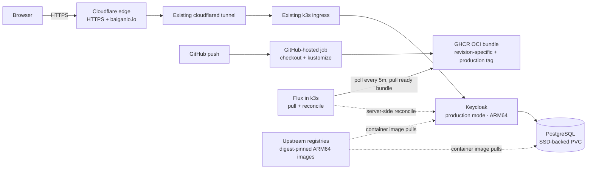

# k3s on Raspberry Pi 5

> NOTE: The manifests are ready for their first deployment but have not yet
> completed an end-to-end test on the real cluster. Keep the PostgreSQL PVC
> until backup and restore have also been tested.

## Why Flux is part of this

If you're wondering why a GitOps controller (Flux) is involved at all instead
of GitHub Actions just deploying directly, here's the reasoning:

The Pi sits behind a Cloudflare Tunnel with no exposed Kubernetes API. GitHub's
hosted runners have no network path to it and hold no cluster credentials.
That rules out the simplest model — a GitHub Actions job running
`kubectl apply` straight against the cluster.

There are two realistic ways to bridge that gap:

1. **Install a self-hosted GitHub Actions runner on the Pi itself.** GitHub
   would then dispatch jobs to the Pi directly, and the Pi could `git clone`
   and `kubectl apply` on every push. This is simple to understand, but it
   means untrusted, CI-triggered code executes on a home server with access to
   your cluster credentials — a bigger blast radius than this project wants
   for a home k3s node.
2. **Publish an artifact, let the cluster pull it (GitOps).** GitHub Actions
   never touches the cluster. It only renders the manifests and publishes them
   as an OCI artifact to GHCR. Flux, running as ordinary controllers inside
   k3s, is the thing that actually pulls that artifact and applies it. The Pi
   only ever pulls; nothing on the internet can push into it directly.

This repository uses option 2. Flux is the "pull" half of that split — it is
what lets the Pi remain a client with no exposed control plane and no inbound
CI credentials, while still getting hands-off deployments on every push. Flux
polls the OCI repository on a five-minute interval, so every push is picked up
and deployed automatically with no inbound connection into the Pi.

## Check where the existing Cloudflare Tunnel runs

```bash
sudo systemctl status cloudflared --no-pager
sudo docker ps --format 'table {{.Names}}\t{{.Image}}\t{{.Status}}'
sudo kubectl get pods -A | grep -i cloudflared
```

Commands reporting a missing `cloudflared` service, missing `docker` command,
or no matching Kubernetes pod are useful results rather than failures. Do not
paste the tunnel token, credentials file, certificate, or the contents of
Cloudflare configuration files.

The inspection established that `cloudflared` 2026.7.3 is installed as an
enabled and active host systemd service, not as a Docker container or
Kubernetes workload. The Cloudflare dashboard also reports that this tunnel is
locally managed. Its hostname routes therefore live in the Pi's local
`cloudflared` configuration file and cannot be changed from the dashboard's
Tunnel routes page. The systemd unit runs as user `lk`, starts tunnel
`3i-atlas`, and loads `/home/lk/.cloudflared/config.yml`.

The observed cluster is:

| Item | Observed value |
| --- | --- |
| Node | `jupiter`, k3s v1.35.6+k3s1 |
| Node address | `192.168.0.113` |
| Operating system | Debian 13 on Raspberry Pi 5 |
| Container runtime | containerd 2.2.5-k3s2 |
| Ingress | Traefik with ServiceLB on host ports 80 and 443 |
| Storage class | `local-path`, `WaitForFirstConsumer` |
| Backing filesystem | 458 GB NVMe ext4 root filesystem |

Both pinned container-image indexes contain a Linux ARM64 image. The PostgreSQL
PVC requests 20 GiB from `local-path`; the provisioner creates its backing
directory when the first PostgreSQL pod is scheduled, so a missing
`/var/lib/rancher/k3s/storage` directory before deployment is not itself an
error.

## Coexistence with other PostgreSQL servers

This PostgreSQL does not bind the Pi's port 5432. It has no `hostPort`,
`NodePort`, `LoadBalancer`, or host-network setting. Port 5432 exists only
inside the PostgreSQL pod and its private `ClusterIP` Service in the `keycloak`
namespace.

It can therefore coexist with:

- a PostgreSQL server listening on the Pi host's port 5432;
- PostgreSQL pods listening on port 5432 in other pods;
- a Service named `postgres` in another Kubernetes namespace.

Keycloak connects to the namespace-local `postgres:5432` Service. Changing this
private port would not improve isolation. The separate namespace, Service, pod
network, and dedicated PVC provide the isolation that matters.

## Automatic GitHub-to-Pi deployment

The canonical public hostname in the manifests is `auth.baiganio.io`. Replace
all occurrences of that hostname under `k8s/` before deploying if it is not the
intended hostname.

The Pi is not a GitHub Actions runner and never clones this repository. The
workflow in `.github/workflows/publish-k3s.yml` runs entirely on a disposable
GitHub-hosted runner:

1. it checks out the triggering revision;
2. renders `k8s/` into one Kubernetes YAML bundle;
3. publishes the bundle to
   `ghcr.io/baiganio/keycloak-manifests:<commit-sha>`;
4. moves the `production` OCI tag to that exact artifact.

Flux runs as ordinary controllers inside k3s and polls that OCI repository on
a five-minute interval. When it sees the `production` tag move, it pulls the
ready artifact from GHCR and applies it — no push mechanism into the cluster
exists, and none is needed. The Pi downloads only the OCI deployment bundle
and the digest-pinned application images.

### One-time Flux and credential bootstrap

Some trust must be established once: install Flux, create the initial database
credentials, and connect its OCI source. These are cluster bootstrap actions,
not application deployments.

After the first workflow publication, make the
`baiganio/keycloak-manifests` GHCR package public. The artifact contains no
credentials.

Install the pinned Flux release on the Pi:

```bash
sudo kubectl apply --server-side \
  -f https://github.com/fluxcd/flux2/releases/download/v2.8.8/install.yaml

sudo kubectl --namespace flux-system wait deployment \
  --all --for=condition=Available --timeout=5m
```

Create the one-time application credentials directly in Kubernetes:

```bash
sudo kubectl create namespace keycloak

read -rsp 'PostgreSQL password: ' KEYCLOAK_POSTGRES_PASSWORD
printf '\n'
read -rsp 'Temporary Keycloak admin password: ' KEYCLOAK_BOOTSTRAP_ADMIN_PASSWORD
printf '\n'
read -rsp 'BGAPI Swagger user password: ' KEYCLOAK_BGAPI_SWAGGER_PASSWORD
printf '\n'

printf 'postgres-password=%s\nbootstrap-admin-password=%s\nbgapi-swagger-password=%s\n' \
  "$KEYCLOAK_POSTGRES_PASSWORD" \
  "$KEYCLOAK_BOOTSTRAP_ADMIN_PASSWORD" \
  "$KEYCLOAK_BGAPI_SWAGGER_PASSWORD" |
  sudo kubectl --namespace keycloak create secret generic keycloak-credentials \
    --from-env-file=/dev/stdin

unset KEYCLOAK_POSTGRES_PASSWORD KEYCLOAK_BOOTSTRAP_ADMIN_PASSWORD KEYCLOAK_BGAPI_SWAGGER_PASSWORD
```

Apply only the Flux source configuration directly from GitHub:

```bash
curl --fail --silent --show-error --location \
  https://raw.githubusercontent.com/BaiGanio/keycloak/master/k8s/flux/keycloak-sync.yaml |
  sudo kubectl apply -f -
```

Flux syncs from GHCR directly and needs no public ingress of its own. The only
new public hostname this deployment needs is `auth.baiganio.io`, routed
through the same locally managed Cloudflare Tunnel. Because the tunnel is
locally managed, add the hostname mapping on the Pi rather than in the
Cloudflare Tunnel dashboard.

The existing configuration already has an `ingress:` list for SSH, TCP, and
HTTP services followed by an `http_status:404` catch-all. Before editing, the
rule check for `auth.baiganio.io` matches that catch-all, confirming that the
hostname does not yet have an explicit route:

```bash
cloudflared tunnel \
  --config /home/lk/.cloudflared/config.yml \
  ingress rule https://auth.baiganio.io
```

Make a one-time backup, then open the user-owned configuration without `sudo`:

```bash
cp --no-clobber \
  /home/lk/.cloudflared/config.yml \
  /home/lk/.cloudflared/config.yml.before-keycloak

nano /home/lk/.cloudflared/config.yml
```

Under the existing `ingress:` list, insert this rule immediately before the
final `- service: http_status:404` rule:

```yaml
  - hostname: auth.baiganio.io
    service: http://localhost:80
```

Merge the rule into the existing list; do not replace the file or remove its
`tunnel`, `credentials-file`, existing SSH/TCP/HTTP hostname rules, or final
catch-all. Rule order matters because `cloudflared` uses the first match, and
the catch-all must remain last. The service is plain local HTTP, so no origin
certificate or `noTLSVerify` setting is needed; preserve the incoming
`auth.baiganio.io` Host header by not setting an `httpHostHeader` override.

Save and exit Nano, then validate the configuration and confirm the hostname
selects its new rule before restarting the service:

```bash
cloudflared tunnel \
  --config /home/lk/.cloudflared/config.yml \
  ingress validate

cloudflared tunnel \
  --config /home/lk/.cloudflared/config.yml \
  ingress rule https://auth.baiganio.io

sudo systemctl restart cloudflared
sudo systemctl status cloudflared --no-pager
```

Create the public DNS mapping separately. The tunnel is named `3i-atlas`; run
the command as `lk` so `cloudflared` can use the account certificate in that
user's configuration directory:

```bash
cloudflared tunnel route dns 3i-atlas auth.baiganio.io
```

If that command reports a missing account certificate, add the record in the
Cloudflare dashboard under **baiganio.io → DNS → Records → Add record**:

```text
Type:         CNAME
Name:         auth
Target:       <tunnel-UUID>.cfargotunnel.com
Proxy status: Proxied
TTL:          Auto
```

The tunnel UUID is the non-secret `tunnel:` value in the local configuration;
it is not the credential JSON contents.

From then on, every relevant push publishes and deploys automatically. No
runner, repository checkout, or application deployment command runs on the Pi.

Verify the public endpoint:

```bash
curl --fail --show-error \
  https://auth.baiganio.io/realms/baiganio/.well-known/openid-configuration
```

Then open <https://auth.baiganio.io/admin/> and sign in as `admin` with the
temporary bootstrap password. Create and verify a permanent administrator
before deleting the temporary account.

The Deployment mounts the committed realm ConfigMap at
`/opt/keycloak/data/import` and starts Keycloak with `--import-realm`. A fresh
database receives the `baiganio` realm, its clients, and the `swagger@baiganio.io`
Swagger user. That user has only the `viewer` role on `bgapi-api`; its password
is read from the non-committed `bgapi-swagger-password` key in
`keycloak-credentials`.
An existing realm is skipped on restart. Changes to the realm file require an
explicit migration and must not be treated as an automatic Flux overwrite.

### Development-only clean reset

For an early development deployment where no Keycloak data needs to be kept,
delete the namespace and recreate the bootstrap secret before Flux reconciles
the manifests. This deletes the Keycloak PostgreSQL PVC and all realms, users,
sessions, and credentials stored in it. Confirm that the cluster StorageClass
does not retain released volumes if a complete data reset is required.

```bash
sudo kubectl delete namespace keycloak
sudo kubectl wait --for=delete namespace/keycloak --timeout=5m

sudo kubectl create namespace keycloak

read -rsp 'PostgreSQL password: ' KEYCLOAK_POSTGRES_PASSWORD
printf '\n'
read -rsp 'Temporary Keycloak admin password: ' KEYCLOAK_BOOTSTRAP_ADMIN_PASSWORD
printf '\n'
read -rsp 'BGAPI Swagger user password: ' KEYCLOAK_BGAPI_SWAGGER_PASSWORD
printf '\n'

printf 'postgres-password=%s\nbootstrap-admin-password=%s\nbgapi-swagger-password=%s\n' \
  "$KEYCLOAK_POSTGRES_PASSWORD" \
  "$KEYCLOAK_BOOTSTRAP_ADMIN_PASSWORD" \
  "$KEYCLOAK_BGAPI_SWAGGER_PASSWORD" |
  sudo kubectl --namespace keycloak create secret generic keycloak-credentials \
    --from-env-file=/dev/stdin

unset KEYCLOAK_POSTGRES_PASSWORD KEYCLOAK_BOOTSTRAP_ADMIN_PASSWORD KEYCLOAK_BGAPI_SWAGGER_PASSWORD

sudo kubectl --namespace flux-system annotate ocirepository/keycloak \
  reconcile.fluxcd.io/requestedAt="$(date +%s)" --overwrite

sudo kubectl --namespace flux-system annotate kustomization/keycloak \
  reconcile.fluxcd.io/requestedAt="$(date +%s)" --overwrite
```

Wait for Flux to recreate the workloads, then verify that the realm import
completed before using the demo account.

### Examine the imported configuration on the cluster

First verify the workload, the mounted realm ConfigMap, and the import log:

```bash
sudo kubectl --namespace keycloak get pods,deployments,configmap realm-import

sudo kubectl --namespace keycloak get configmap realm-import -o json |
  jq -r '.data["baiganio-realm.json"]' |
  jq '{realm,clients:[.clients[].clientId],api_roles:[.roles.client."bgapi-api"[].name]}'

sudo kubectl --namespace keycloak logs deployment/keycloak --since=15m |
  grep -E "Realm 'baiganio' imported|Import finished successfully|started in" || true
```

Then verify the public issuer and inspect the live clients and roles. Use a
permanent administrator after the bootstrap account has been retired:

```bash
curl --fail --silent \
  https://auth.baiganio.io/realms/baiganio/.well-known/openid-configuration |
  jq '{issuer,authorization_endpoint,token_endpoint,jwks_uri}'

read -rsp 'Keycloak admin password: ' KEYCLOAK_ADMIN_PASSWORD
printf '\n'
access_token="$(curl --fail --silent \
  --data-urlencode 'client_id=admin-cli' \
  --data-urlencode 'username=admin' \
  --data-urlencode "password=$KEYCLOAK_ADMIN_PASSWORD" \
  --data-urlencode 'grant_type=password' \
  https://auth.baiganio.io/realms/master/protocol/openid-connect/token |
  jq -er .access_token)"
unset KEYCLOAK_ADMIN_PASSWORD

curl --fail --silent \
  -H "Authorization: Bearer $access_token" \
  'https://auth.baiganio.io/admin/realms/baiganio/clients?briefRepresentation=true' |
  jq '[.[].clientId]'

api_client_uuid="$(curl --fail --silent \
  -H "Authorization: Bearer $access_token" \
  'https://auth.baiganio.io/admin/realms/baiganio/clients?clientId=bgapi-api' |
  jq -er '.[0].id')"

curl --fail --silent \
  -H "Authorization: Bearer $access_token" \
  "https://auth.baiganio.io/admin/realms/baiganio/clients/$api_client_uuid/roles" |
  jq '[.[].name]'
```

Expected clients are `bgapi-api`, `bgapi-swagger`, `baiganio-web`, and
`cosmic-origins-web`; expected API roles are `admin`, `user`, and `viewer`.

## First architecture

The first deployed architecture is:



Kubernetes resources:

| Resource | First-iteration purpose |
| --- | --- |
| Namespace | Keep the deployment isolated as `keycloak` |
| Secret | Supply database and bootstrap credentials without committing values |
| PostgreSQL workload | Run one PostgreSQL instance in the cluster |
| PostgreSQL PVC | Keep database files on the Pi's SSD |
| Keycloak Deployment | Run one production-mode Keycloak replica initially |
| ClusterIP Services | Expose PostgreSQL internally and Keycloak to ingress |
| Ingress | Route the chosen `baiganio.io` hostname to Keycloak |
| Resource settings | Prevent Keycloak from consuming all 8 GB on a shared Pi |
| Startup/readiness probes | Keep traffic away while Keycloak is starting |

The manifests use the observed `local-path` storage class and Traefik ingress.
PostgreSQL is not exposed outside the cluster. Keycloak requests 1 GiB of
memory and is limited to 2 GiB; PostgreSQL requests 256 MiB and is limited to
1 GiB, leaving capacity for k3s and the Pi's other workloads.

PostgreSQL deliberately sets `PGDATA` to
`/var/lib/postgresql/data/pgdata`, one level below the PVC mount. The
`local-path` provisioner creates the mount root with ownership that the
non-root PostgreSQL process cannot change; using a child directory lets
PostgreSQL create and own its database directory without weakening the
container security context. If PostgreSQL reports `initdb: could not change
permissions of directory "/var/lib/postgresql/data"`, confirm that the
deployed StatefulSet still contains this `PGDATA` setting.

Keycloak consumes the two Secret-backed passwords through the `KCRAW_`
environment-variable prefix. Keycloak otherwise evaluates expressions in
ordinary `KC_` values and can silently alter passwords containing `$`;
`KCRAW_` preserves the exact credential bytes stored in the Kubernetes
Secret.

## Cloudflare Tunnel and TLS boundary

The configured public hostname is `auth.baiganio.io`. Cloudflare terminates
public HTTPS. The host `cloudflared` service then forwards traffic to the local
k3s Traefik ingress over HTTP.

This can avoid adding cert-manager in the first iteration. It does not remove
the need to configure Keycloak with its public hostname and trusted proxy
headers; otherwise redirects, cookies, issuer URLs, and the Admin Console can
use the wrong scheme or host.

Direct LAN access and access through the public hostname are not automatically
interchangeable. OIDC clients validate the issuer exactly. The public
`https://auth.baiganio.io` issuer should be the canonical identity once the
tunnel is enabled.

## GitHub-to-Pi deployment model

The k3s deployment uses the digest-pinned upstream ARM64-compatible Keycloak
image and mounts the canonical realm file through a generated ConfigMap. The
Azure-only wrapper image is not used in k3s.

GitHub Actions has no Kubernetes credential and cannot access the Pi's
Kubernetes API. Flux has no repository checkout and pulls only the published
OCI artifact, on its own five-minute reconciliation schedule — there is no
push mechanism into the cluster.

Do not use the mutable `latest` tag. A deployment must identify the exact image
that was built, making its state understandable and rollback possible.

## Secrets boundary

Database and Keycloak credentials exist only in the Kubernetes Secret created
during cluster bootstrap; GitHub never receives them. Running
`kubectl get secret ... -o yaml` does not safely reveal or audit a secret; its
values are merely base64-encoded.

SOPS, Sealed Secrets, External Secrets, and a PostgreSQL operator are reasonable
later options for automating secret rotation and database operations.

## Relationship to the existing SD-card backup guide

The separate
[`k3s-pi5` SD-card backup example](https://github.com/BaiGanio/k3s-pi5/blob/master/modules/k3s-pi5/sd-card-backup.js)
is useful because it combines logical PostgreSQL dumps with copies of k3s
configuration and persistent-volume data.

It is not automatically compatible with this deployment. Its example contains
assumptions such as a particular `postgres` Deployment, namespace, database
user, `/mnt/k3s-data` path, and application workload names. This Keycloak
deployment may instead use a StatefulSet, a different namespace, a dynamically
provisioned PVC, and different credentials.

For the first iteration, the guide is treated as an existing cluster-level
safety mechanism to inspect, not as a verified Keycloak restore procedure.
Later work will adapt the logical `pg_dump` step to the actual Keycloak
PostgreSQL resource and test a restore. Copying live PostgreSQL data files by
itself is not a substitute for a database-consistent backup.

## Deferred work

The following are intentionally documented but not required to get the first
Pi deployment running:

- scheduled and encrypted PostgreSQL-aware backups;
- a tested PostgreSQL restore procedure;
- multi-node replicated storage or highly available PostgreSQL;
- automated discovery, Admin Console, login, and token smoke tests;
- rehearsed Keycloak and PostgreSQL upgrade and rollback procedures;
- disaster-recovery drills for loss of the node or SSD;
- secret-management operators;
- cert-manager, unless the observed ingress/tunnel layout requires origin TLS;
- multiple Keycloak replicas and load testing.

These items become meaningful only after the initial workload, storage,
hostname, ingress, and deployment flow are verified on the real Pi.
