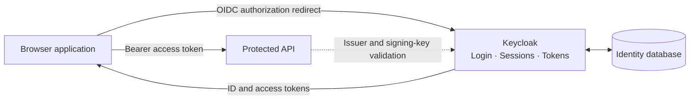
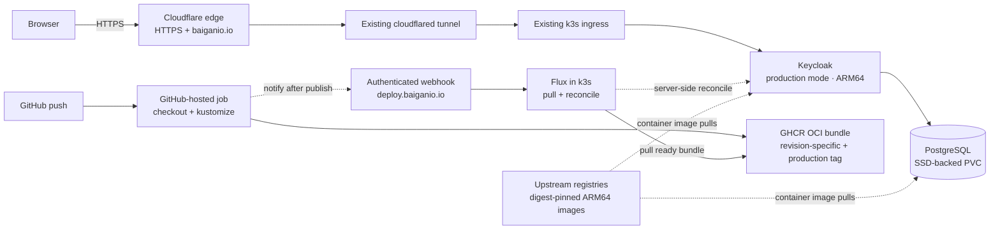

# Keycloak backbone

This repository is a starting point for a shared Keycloak identity service that
can support multiple applications. The target environments are being developed
and documented in this order:

1. local development with Docker Compose;
2. Azure;
3. k3s on Raspberry Pi 5.

The local Docker workflow is usable for development. Azure has a documented,
cost-constrained proof-of-concept deployment that still requires validation in
an Azure subscription. The first k3s manifests have been prepared for the Pi 5
cluster and still require an end-to-end deployment test on that cluster.

## Repository contents

| Path | Purpose | Status |
| --- | --- | --- |
| `docker-compose.yml` | Runs Keycloak with PostgreSQL for local development | Usable; data persists in a named volume |
| `zDOCKER.md` | Local Docker instructions and troubleshooting | Development guide |
| `main.bicep` | Azure App Service and free-offer Azure SQL Database | Production-configured PoC; Azure validation required |
| `main.bicepparam` | Sweden Central PoC parameters | Reads passwords from environment variables |
| `azuredeploy.json` | Generated native ARM template equivalent to `main.bicep` | Use for portal deployment or deployment stacks |
| `.github/workflows/deploy-azure.yml` | Validates, deploys, and smoke-tests Azure | Manual GitHub Actions workflow |
| `.github/workflows/operate-azure.yml` | Starts, stops, or reports Azure resource state | Manual GitHub Actions workflow |
| `zAZURE.md` | Azure deployment and operations instructions | PoC guide; Azure validation required |
| `k8s/` | Runs Keycloak with PostgreSQL on the Pi 5 k3s cluster | Ready for first cluster deployment |
| `k8s/flux/keycloak-sync.yaml` | Makes Flux pull and apply the published OCI bundle | One-time Pi bootstrap |
| `.github/workflows/publish-k3s.yml` | Publishes deployment bundles to GHCR and notifies Flux | Runs only on GitHub-hosted infrastructure |

## Architecture

Keycloak owns login, sessions, users, roles, and token issuance. Applications
redirect users to Keycloak for authentication and APIs validate the access
tokens that Keycloak issues.



Keycloak's login pages and Admin Console are served by Keycloak itself. They are
not a standalone frontend that can be hosted separately.

---

## k3s on Raspberry Pi 5

> NOTE: The manifests are ready for their first deployment but have not yet
> completed an end-to-end test on the real cluster. Keep the PostgreSQL PVC
> until backup and restore have also been tested.

Check where the existing Cloudflare Tunnel runs:

```bash
sudo systemctl status cloudflared --no-pager
sudo docker ps --format 'table {{.Names}}\t{{.Image}}\t{{.Status}}'
sudo kubectl get pods -A | grep -i cloudflared
```

Commands reporting a missing `cloudflared` service, missing `docker` command,
or no matching Kubernetes pod are useful results rather than failures. Do not
paste the tunnel token, credentials file, certificate, or the contents of
Cloudflare configuration files.

The inspection established that `cloudflared` 2026.7.3 is installed as an
enabled and active host systemd service, not as a Docker container or
Kubernetes workload.

The observed cluster is:

| Item | Observed value |
| --- | --- |
| Node | `jupiter`, k3s v1.35.6+k3s1 |
| Node address | `192.168.0.113` |
| Operating system | Debian 13 on Raspberry Pi 5 |
| Container runtime | containerd 2.2.5-k3s2 |
| Ingress | Traefik with ServiceLB on host ports 80 and 443 |
| Storage class | `local-path`, `WaitForFirstConsumer` |
| Backing filesystem | 458 GB NVMe ext4 root filesystem |

Both pinned container-image indexes contain a Linux ARM64 image. The PostgreSQL
PVC requests 20 GiB from `local-path`; the provisioner creates its backing
directory when the first PostgreSQL pod is scheduled, so a missing
`/var/lib/rancher/k3s/storage` directory before deployment is not itself an
error.

### Coexistence with other PostgreSQL servers

This PostgreSQL does not bind the Pi's port 5432. It has no `hostPort`,
`NodePort`, `LoadBalancer`, or host-network setting. Port 5432 exists only
inside the PostgreSQL pod and its private `ClusterIP` Service in the `keycloak`
namespace.

It can therefore coexist with:

- a PostgreSQL server listening on the Pi host's port 5432;
- PostgreSQL pods listening on port 5432 in other pods;
- a Service named `postgres` in another Kubernetes namespace.

Keycloak connects to the namespace-local `postgres:5432` Service. Changing this
private port would not improve isolation. The separate namespace, Service, pod
network, and dedicated PVC provide the isolation that matters.

### Automatic GitHub-to-Pi deployment

The canonical public hostname in the manifests is `auth.baiganio.io`. Replace
all occurrences of that hostname under `k8s/` before deploying if it is not the
intended hostname.

The Pi is not a GitHub Actions runner and never clones this repository. The
workflow in `.github/workflows/publish-k3s.yml` runs entirely on a disposable
GitHub-hosted runner:

1. it checks out the triggering revision;
2. renders `k8s/` into one Kubernetes YAML bundle;
3. publishes the bundle to
   `ghcr.io/baiganio/keycloak-manifests:<commit-sha>`;
4. moves the `production` OCI tag to that exact artifact;
5. sends an authenticated webhook after publication.

Flux runs as ordinary controllers inside k3s. The webhook tells Flux to
reconcile immediately; Flux pulls the ready OCI artifact from GHCR and applies
it. A five-minute polling interval provides recovery if a webhook is missed.
The Pi downloads only the OCI deployment bundle and the digest-pinned
application images.

#### One-time Flux and credential bootstrap

Some trust must be established once: install Flux, create the initial database
credentials, and connect its OCI source. These are cluster bootstrap actions,
not application deployments.

After the first workflow publication, make the
`baiganio/keycloak-manifests` GHCR package public. The artifact contains no
credentials.

Install the pinned Flux release on the Pi:

```bash
sudo kubectl apply --server-side \
  -f https://github.com/fluxcd/flux2/releases/download/v2.8.8/install.yaml

sudo kubectl --namespace flux-system wait deployment \
  --all --for=condition=Available --timeout=5m
```

Create the one-time application credentials directly in Kubernetes:

```bash
sudo kubectl create namespace keycloak

read -rsp 'PostgreSQL password: ' KEYCLOAK_POSTGRES_PASSWORD
printf '\n'
read -rsp 'Temporary Keycloak admin password: ' KEYCLOAK_BOOTSTRAP_ADMIN_PASSWORD
printf '\n'

printf 'postgres-password=%s\nbootstrap-admin-password=%s\n' \
  "$KEYCLOAK_POSTGRES_PASSWORD" \
  "$KEYCLOAK_BOOTSTRAP_ADMIN_PASSWORD" |
  sudo kubectl --namespace keycloak create secret generic keycloak-credentials \
    --from-env-file=/dev/stdin

unset KEYCLOAK_POSTGRES_PASSWORD KEYCLOAK_BOOTSTRAP_ADMIN_PASSWORD
```

Generate a separate webhook token, save it as the `FLUX_WEBHOOK_TOKEN` secret
in the GitHub `pi-production` environment, then enter that same value silently
on the Pi:

```bash
read -rsp 'Flux webhook token: ' FLUX_WEBHOOK_TOKEN
printf '\n'

printf 'token=%s\n' "$FLUX_WEBHOOK_TOKEN" |
  sudo kubectl --namespace flux-system create secret generic \
    keycloak-webhook-token \
    --from-env-file=/dev/stdin

unset FLUX_WEBHOOK_TOKEN
```

Apply only the Flux source configuration directly from GitHub:

```bash
curl --fail --silent --show-error --location \
  https://raw.githubusercontent.com/BaiGanio/keycloak/master/k8s/flux/keycloak-sync.yaml |
  sudo kubectl apply -f -
```

Flux exposes its authenticated receiver through the
`deploy.baiganio.io` Ingress. Add this Cloudflare Tunnel route:

```text
Public hostname: deploy.baiganio.io
Service:         http://127.0.0.1:80
```

Get the receiver's unguessable path:

```bash
sudo kubectl --namespace flux-system get receiver keycloak \
  --output=jsonpath='{.status.webhookPath}{"\n"}'
```

Save `https://deploy.baiganio.io` plus that path as the
`FLUX_WEBHOOK_URL` secret in the same GitHub environment. From then on, every
relevant push publishes and deploys automatically. No runner, repository
checkout, or application deployment command runs on the Pi.

"Local target URL" means the private service to which Cloudflare sends requests
after accepting traffic for the public hostname. For example:

```text
Public hostname: auth.baiganio.io
Local service:   http://127.0.0.1:80
```

For a remotely managed tunnel, sign in to the Cloudflare dashboard and open
**Zero Trust → Networks → Connectors → Cloudflare Tunnels**, choose the tunnel,
and add or inspect its published application route:

```text
Public hostname: auth.baiganio.io
Service:         http://127.0.0.1:80
```

The incoming `Host` header should remain `auth.baiganio.io`; set the route's
HTTP Host Header origin parameter to that value if another value is configured.
No origin certificate or `noTLSVerify` setting is needed for this local HTTP
hop. After saving the route, verify the public endpoint:

```bash
curl --fail --show-error \
  https://auth.baiganio.io/realms/master/.well-known/openid-configuration
```

Then open <https://auth.baiganio.io/admin/> and sign in as `admin` with the
temporary bootstrap password. Create and verify a permanent administrator
before deleting the temporary account.

For a locally managed tunnel, this command reports the matching ingress rule
without displaying the tunnel credential:

```bash
sudo cloudflared tunnel ingress rule https://auth.baiganio.io
```

If it reports that no configuration file or rule exists, configure the route
later rather than inventing one now. Do not paste `systemctl cat cloudflared`
output because a remotely managed service unit may contain its tunnel token.

### First architecture

The first deployed architecture is:



Kubernetes resources:

| Resource | First-iteration purpose |
| --- | --- |
| Namespace | Keep the deployment isolated as `keycloak` |
| Secret | Supply database and bootstrap credentials without committing values |
| PostgreSQL workload | Run one PostgreSQL instance in the cluster |
| PostgreSQL PVC | Keep database files on the Pi's SSD |
| Keycloak Deployment | Run one production-mode Keycloak replica initially |
| ClusterIP Services | Expose PostgreSQL internally and Keycloak to ingress |
| Ingress | Route the chosen `baiganio.io` hostname to Keycloak |
| Resource settings | Prevent Keycloak from consuming all 8 GB on a shared Pi |
| Startup/readiness probes | Keep traffic away while Keycloak is starting |

The manifests use the observed `local-path` storage class and Traefik ingress.
PostgreSQL is not exposed outside the cluster. Keycloak requests 1 GiB of
memory and is limited to 2 GiB; PostgreSQL requests 256 MiB and is limited to
1 GiB, leaving capacity for k3s and the Pi's other workloads.

### Cloudflare Tunnel and TLS boundary

The configured public hostname is `auth.baiganio.io`. Cloudflare terminates
public HTTPS. The host `cloudflared` service then forwards traffic to the local
k3s Traefik ingress over HTTP.

This can avoid adding cert-manager in the first iteration. It does not remove
the need to configure Keycloak with its public hostname and trusted proxy
headers; otherwise redirects, cookies, issuer URLs, and the Admin Console can
use the wrong scheme or host.

Direct LAN access and access through the public hostname are not automatically
interchangeable. OIDC clients validate the issuer exactly. The public
`https://auth.baiganio.io` issuer should be the canonical identity once the
tunnel is enabled.

### GitHub-to-Pi deployment model

There is currently no custom Keycloak `Dockerfile` in this repository. Until
one is added, deployment uses the digest-pinned upstream ARM64-compatible
Keycloak and PostgreSQL images. A later custom image must be published with an
immutable tag or digest before the deployment bundle is published.

GitHub Actions has no Kubernetes credential and cannot access the Pi's
Kubernetes API. Flux has no repository checkout and pulls only the published
OCI artifact. The HMAC-authenticated receiver requests an immediate pull after
publication; periodic reconciliation remains the source of eventual recovery.

Do not use the mutable `latest` tag. A deployment must identify the exact image
that was built, making its state understandable and rollback possible.

### Secrets boundary

Database and Keycloak credentials exist only in the Kubernetes Secret created
during cluster bootstrap; GitHub never receives them. The separate webhook
token exists in both the Kubernetes Receiver Secret and the `pi-production`
GitHub environment. Running `kubectl get secret ... -o yaml` does not safely
reveal or audit a secret; its values are merely base64-encoded.

SOPS, Sealed Secrets, External Secrets, and a PostgreSQL operator are reasonable
later options for automating secret rotation and database operations.

### Relationship to the existing SD-card backup guide

The separate
[`k3s-pi5` SD-card backup example](https://github.com/BaiGanio/k3s-pi5/blob/master/modules/k3s-pi5/sd-card-backup.js)
is useful because it combines logical PostgreSQL dumps with copies of k3s
configuration and persistent-volume data.

It is not automatically compatible with this deployment. Its example contains
assumptions such as a particular `postgres` Deployment, namespace, database
user, `/mnt/k3s-data` path, and application workload names. This Keycloak
deployment may instead use a StatefulSet, a different namespace, a dynamically
provisioned PVC, and different credentials.

For the first iteration, the guide is treated as an existing cluster-level
safety mechanism to inspect, not as a verified Keycloak restore procedure.
Later work will adapt the logical `pg_dump` step to the actual Keycloak
PostgreSQL resource and test a restore. Copying live PostgreSQL data files by
itself is not a substitute for a database-consistent backup.

### Deferred work

The following are intentionally documented but not required to get the first
Pi deployment running:

- scheduled and encrypted PostgreSQL-aware backups;
- a tested PostgreSQL restore procedure;
- multi-node replicated storage or highly available PostgreSQL;
- automated discovery, Admin Console, login, and token smoke tests;
- rehearsed Keycloak and PostgreSQL upgrade and rollback procedures;
- disaster-recovery drills for loss of the node or SSD;
- secret-management operators;
- cert-manager, unless the observed ingress/tunnel layout requires origin TLS;
- multiple Keycloak replicas and load testing.

These items become meaningful only after the initial workload, storage,
hostname, ingress, and deployment flow are verified on the real Pi.
