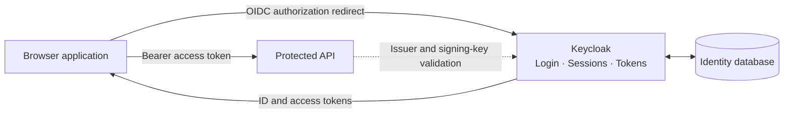

# Keycloak backbone

This repository is a starting point for a shared Keycloak identity service that
can support multiple applications. [Keycloak](https://www.keycloak.org/) is an
open-source identity and access management server: it handles login pages,
sessions, users, roles, and issuing the tokens that let other apps trust that
you are who you say you are, so individual applications don't need to build
their own login system.

Keycloak's login pages and Admin Console are served by Keycloak itself — there
is no separate frontend to build or host.

## Three ways to run it

This project is meant to run the same way in three different places,
documented separately so each guide stays focused and readable:

| Scenario | Guide | Status |
| --- | --- | --- |
| **A. Local development** — a disposable container for a quick look, or a persistent one for a week or two of work | [`DOCKER.md`](DOCKER.md) | Usable today |
| **B. Azure** — a production-shaped template you can deploy and run on Azure | [`AZURE.md`](AZURE.md) | Cost-constrained proof of concept; not yet validated end-to-end in a subscription |
| **C. k3s on a Raspberry Pi 5** — a home k3s cluster, deployed automatically from GitHub via GitOps | [`K3SPI5.md`](K3SPI5.md) | Manifests and pipeline are prepared; first real deployment to the cluster is still pending |

Each guide is self-contained: prerequisites, step-by-step commands, the
architecture for that environment, and troubleshooting. This README stays
short on purpose — pick your scenario above and open its guide.

## Repository contents

| Path | Purpose |
| --- | --- |
| `docker-compose.yml` | Runs Keycloak with PostgreSQL for local development |
| `DOCKER.md` | Local Docker instructions and troubleshooting |
| `k8s/realm/baiganio-realm.json` | Canonical realm, clients, roles, and import placeholders |
| `dev/realm/baiganio-dev-realm.json` | Local-only `baiganio-dev` realm with public test users and clients; never deployed |
| `scripts/reset-dev-realm.sh` | Deletes and reloads only the local `baiganio-dev` realm |
| `DEV_REALM.md` | Team note: how apps use the dev realm's test users and clients |
| `azure/Dockerfile` | Azure-only wrapper image carrying the canonical realm file |
| `azure/main.bicep` | Azure App Service and free-offer Azure SQL Database template |
| `azure/main.bicepparam` | Sweden Central proof-of-concept parameters |
| `azure/azuredeploy.json` | Generated native ARM template equivalent to `main.bicep` |
| `.github/workflows/deploy-azure.yml` | Manual GitHub Actions workflow: validates, deploys, and smoke-tests Azure |
| `.github/workflows/operate-azure.yml` | Manual GitHub Actions workflow: starts, stops, or reports Azure resource state |
| `AZURE.md` | Azure deployment and operations instructions |
| `k8s/` | Runs Keycloak with PostgreSQL on the Pi 5 k3s cluster |
| `k8s/backup.yaml` | Nightly `pg_dump` CronJob and the volume its dumps are written to |
| `k8s/flux/keycloak-sync.yaml` | One-time Pi bootstrap: makes Flux pull and apply the published bundle |
| `.github/workflows/publish-k3s.yml` | Publishes deployment bundles to GHCR and notifies Flux |
| `K3SPI5.md` | k3s/Raspberry Pi deployment instructions, including why Flux is used |

## Realms, clients, and users

All three environments import the committed [`baiganio` realm](k8s/realm/baiganio-realm.json)
on first boot. `master` remains reserved for administration. The realm contains
the `bgapi-api`, `bgapi-swagger`, `baiganio-web`, and `cosmic-origins-web`
clients, plus the `admin`, `user`, and `viewer` roles on `bgapi-api`.

Realm import is creation-only on startup: a restart skips an existing realm.
Later realm changes require an explicit, reviewed migration; they are not
silently applied by a container restart or Flux reconciliation.

## License

See [`LICENSE`](LICENSE).
