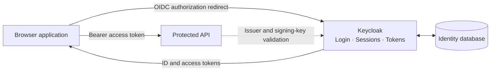

# Keycloak backbone

This repository is a starting point for a shared Keycloak identity service that
can support multiple applications. The target environments are being developed
and documented in this order:

1. local development with Docker Compose;
2. Azure;
3. k3s on Raspberry Pi 5.

Only the local Docker workflow is documented as a usable path today. The Azure
template is an early draft, and there is not yet a k3s deployment in the
repository.

## Repository contents

| Path | Purpose | Status |
| --- | --- | --- |
| `docker-compose.yml` | Runs one Keycloak server for local development | Usable for local experiments |
| `main.bicep` | Azure Container Apps and PostgreSQL experiment | Draft; not production-ready |

## Architecture

Keycloak owns login, sessions, users, roles, and token issuance. Applications
redirect users to Keycloak for authentication and APIs validate the access
tokens that Keycloak issues.



Keycloak's login pages and Admin Console are served by Keycloak itself. They are
not a standalone frontend that can be hosted separately.

## Local development with Docker

### Prerequisites

- Docker Desktop, Docker Engine with the Compose plugin, or an equivalent
  Docker-compatible environment
- Docker Compose v2 (`docker compose`, not the legacy `docker-compose` command)
- port `8080` available on the host

Confirm that Docker is running:

```bash
docker info
docker compose version
```

### Start Keycloak

From the repository root:

```bash
docker compose pull
docker compose up -d
docker compose logs -f keycloak
```

Wait for the log message that says Keycloak has started, then open:

- Admin Console: <http://localhost:8080/admin/>
- OpenID Connect discovery document:
  <http://localhost:8080/realms/master/.well-known/openid-configuration>

The development bootstrap credentials currently defined in
`docker-compose.yml` are:

```text
username: admin
password: admin
```

### Temporary bootstrap administrator

After logging in as `admin`, Keycloak displays this message:

> You are logged in as a temporary admin user. To harden security, create a
> permanent admin account and delete the temporary one.

This is expected. `KC_BOOTSTRAP_ADMIN_USERNAME` and
`KC_BOOTSTRAP_ADMIN_PASSWORD` create a full-access account whose purpose is to
bootstrap or recover administrator access. "Temporary" is an account
classification and does not mean that it will expire after a few minutes.

For this disposable local environment, it is acceptable to keep using the
temporary `admin` account while experimenting. Do not keep it for a persistent,
shared, or production environment.

To replace it with a permanent server administrator:

1. Log in with `admin` and make sure the current realm is **master**.
2. Open **Users**, choose **Add user**, enter a new administrator username, and
   create the user.
3. Open the new user's **Credentials** tab and set a strong password with
   **Temporary** set to **Off**.
4. Open **Role mapping**, choose **Assign role**, filter by realm roles, and
   assign the `admin` role.
5. Log out and verify that the new account can sign in to the Admin Console and
   manage realms.
6. Only after that verification, sign in with the new account and delete the
   temporary `admin` user.

The current Compose setup has no persistent volume. If the container is removed,
both the permanent administrator and all other configuration are lost. A fresh
container will create the temporary bootstrap `admin` again. Add the development
volume described below before investing in configuration that must survive
`docker compose down`.

You can also check that the HTTP endpoint is responding without opening a
browser:

```bash
curl --fail \
  http://localhost:8080/realms/master/.well-known/openid-configuration
```

The first startup can take longer while Docker downloads the image and Keycloak
initializes its local database.

### Container lifecycle

Run these commands from the repository root:

| Task | Command |
| --- | --- |
| Show status | `docker compose ps` |
| Follow logs | `docker compose logs -f keycloak` |
| Stop without removing the container | `docker compose stop` |
| Start a stopped container | `docker compose start` |
| Restart Keycloak | `docker compose restart keycloak` |
| Remove the container and Compose network | `docker compose down` |
| Pull the configured image and recreate | `docker compose pull && docker compose up -d` |

Press `Ctrl+C` to stop following logs. Because Keycloak is started in detached
mode, this does not stop the server.

### Data persistence and reset behavior

The current Compose service does not mount a volume. Keycloak's development
database therefore lives in the container's writable layer:

- `docker compose stop` followed by `docker compose start` keeps the data;
- `docker compose down` removes the container and loses locally created realms,
  clients, users, and settings;
- recreating or replacing the container can also lose that data.

This behavior is useful for quick, disposable tests. For local configuration
that must survive container recreation, add a named volume:

```yaml
services:
  keycloak:
    volumes:
      - keycloak_data:/opt/keycloak/data

volumes:
  keycloak_data:
```

The embedded `dev-file` database and this volume pattern are for development
only. Azure and k3s deployments will use PostgreSQL and an explicit backup and
recovery strategy.

To reset a setup that uses the named volume, remove the stack and its volumes:

```bash
docker compose down --volumes
```

This permanently deletes the local Keycloak data in that Compose project.

### Local security boundaries

The Compose configuration deliberately favors convenience and must not be used
as a production deployment:

- `start-dev` enables development-mode defaults;
- the bootstrap administrator password is public and trivial;
- HTTP is used instead of HTTPS;
- `8080:8080` may publish Keycloak on every host network interface, depending
  on the Docker environment and host firewall;
- `quay.io/keycloak/keycloak:latest` is a moving image tag, so a pull can
  introduce an unplanned upgrade;
- there is no external database, backup, health check, resource limit, or
  production proxy configuration.

To restrict the development port to the host machine, change the port mapping
in `docker-compose.yml` to:

```yaml
ports:
  - "127.0.0.1:8080:8080"
```

Before the Azure and k3s work begins, the image must also be pinned to an
explicit, tested Keycloak version.

### Troubleshooting

**Docker cannot connect to the daemon**

Start Docker Desktop or the Docker service, then retry `docker info`.

**Port 8080 is already in use**

Find the process or container using the port, or change the host side of the
mapping, for example `127.0.0.1:8180:8080`. If the port changes, use
`http://localhost:8180` in local application configuration.

**Keycloak exits during startup**

Inspect the complete logs and the resolved Compose configuration:

```bash
docker compose logs keycloak
docker compose config
```

**The admin credentials no longer work**

The bootstrap environment variables create a temporary administrator only when
the `master` realm is first created; they do not reset an existing
administrator's password. For this repository's disposable, non-volume setup,
`docker compose down` followed by `docker compose up -d` creates a fresh server.
Do not do this if the container contains data you need.

## Azure deployment

Azure is the next documentation and implementation phase. `main.bicep` is a
useful inventory of intended services—Container Apps, PostgreSQL Flexible
Server, Key Vault, managed identity, Log Analytics, and Application
Insights—but it has not been validated as a deployable production architecture.

Known items to resolve before documenting an Azure deployment include:

- pinning and upgrading the Keycloak image deliberately;
- replacing obsolete proxy settings with configuration supported by the pinned
  Keycloak release;
- using private database networking instead of the current all-addresses
  firewall rule;
- validating regional PostgreSQL SKU, high-availability, and backup
  combinations;
- parameterizing hostname and TLS configuration;
- validating managed-identity access to Key Vault;
- adding health/readiness probes, sizing, migration, rollback, and backup
  procedures;
- checking the template with Bicep validation and deploying it to a disposable
  Azure resource group.

Do not use the current template for a production deployment.

## k3s on Raspberry Pi 5

The k3s phase will follow the Azure work. No active Kubernetes manifests or Helm
values are currently present. That phase will cover, at minimum, ARM64 image
compatibility, persistent storage, PostgreSQL, ingress and TLS, secrets,
resource sizing, probes, backups, upgrades, and recovery.

## References

- [Keycloak: Get started with Docker](https://www.keycloak.org/getting-started/getting-started-docker)
- [Keycloak: Running in a container](https://www.keycloak.org/server/containers)
- [Keycloak: Bootstrapping and recovering an admin account](https://www.keycloak.org/server/bootstrap-admin-recovery)
- [Keycloak: Server Administration Guide](https://www.keycloak.org/docs/latest/server_admin/)
- [Keycloak: Configuring for production](https://www.keycloak.org/server/configuration-production)
- [Keycloak: Configuring the database](https://www.keycloak.org/server/db)
- [Docker Compose documentation](https://docs.docker.com/compose/)
