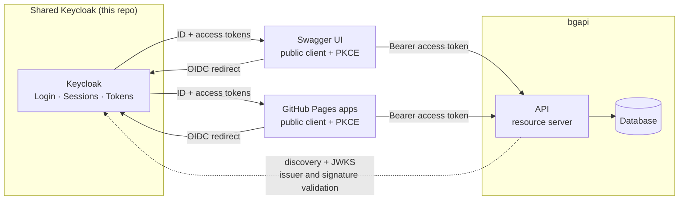

# Integrating with the BaiGanio Keycloak backbone

For the **bgapi** team: how the API and its front-ends offload login and token
issuance to the shared Keycloak instance in this repo, instead of each building
its own auth.

> **Status: the realm and client contract is implemented.**
>
> Everything in *what you must validate* and *what you must never trust* remains
> the contract. The concrete realm and client values below are now committed in
> this repository.
>
> The `baiganio` realm and its clients are imported in all three environments.
> Users and role assignments remain operational tasks.

---

## The shape of the system

One API, several front-ends that trust it. Every front-end sends the user to
Keycloak to log in, gets tokens back, and calls the API with an access token as
a bearer credential. The API never sees a password.



**The API is the perimeter.** The database is not meant to be reachable except
through the API, so the API rejecting a bad token *is* the security boundary —
not a formality on top of one. That is the single most important sentence in
this document.

---

## Implemented values

| What | Placeholder used below | Decided by |
|---|---|---|
| Realm name | `baiganio` | [#4 Realm structure](https://github.com/BaiGanio/keycloak/issues/4) |
| Production issuer URL | `https://auth.baiganio.io/realms/baiganio` | [#4](https://github.com/BaiGanio/keycloak/issues/4) |
| API client id / audience | `bgapi-api` | [#5 Client topology](https://github.com/BaiGanio/keycloak/issues/5) |
| Swagger UI client id | `bgapi-swagger` | [#5](https://github.com/BaiGanio/keycloak/issues/5) |
| BaiGanio client id | `baiganio-web` | [#5](https://github.com/BaiGanio/keycloak/issues/5) |
| Cosmic Origins client id | `cosmic-origins-web` | [#5](https://github.com/BaiGanio/keycloak/issues/5) |
| API client roles | `admin`, `user`, `viewer` | [#5](https://github.com/BaiGanio/keycloak/issues/5) |

Issuer host per environment:

| Environment | Keycloak base URL |
|---|---|
| Local Docker (`docker compose up`) | `http://localhost:8080/realms/baiganio` |
| Azure | `https://lk-keycloak.azurewebsites.net/realms/baiganio` |
| k3s (production target) | `https://auth.baiganio.io/realms/baiganio` |

The realm name is `baiganio` everywhere. **Treat the whole issuer URL as one
configured string**, because the host still differs by environment.

---

## The API: validating tokens

### What you must validate

A token is acceptable only if **all** of these hold. Checking that a token was
merely *present* is the failure mode this whole setup exists to prevent.

1. **Signature** verifies against Keycloak's published signing keys (JWKS),
   fetched from the discovery document — never a key pasted into config, so
   that key rotation does not break you.
2. **Issuer** (`iss`) exactly equals the configured issuer URL.
3. **Audience** (`aud`) contains your API's client id. See the trap below.
4. **Lifetime** (`exp`, `nbf`) is current, with only a small clock-skew
   allowance.

### Setup

```bash
dotnet add package Microsoft.AspNetCore.Authentication.JwtBearer
```

```jsonc
// appsettings.json — values differ per environment, so keep them in config
{
  "Keycloak": {
    "Issuer": "https://auth.baiganio.io/realms/baiganio",
    "Audience": "bgapi-api"
  }
}
```

```csharp
var kc = builder.Configuration.GetSection("Keycloak");

builder.Services
    .AddAuthentication(JwtBearerDefaults.AuthenticationScheme)
    .AddJwtBearer(options =>
    {
        // Authority makes the handler fetch /.well-known/openid-configuration
        // and the JWKS itself, and refresh keys when Keycloak rotates them.
        options.Authority = kc["Issuer"];
        options.Audience  = kc["Audience"];

        // Only ever false against a local http Keycloak. Never in a deployed environment.
        options.RequireHttpsMetadata = !builder.Environment.IsDevelopment();

        options.TokenValidationParameters = new TokenValidationParameters
        {
            ValidateIssuer           = true,
            ValidIssuer              = kc["Issuer"],
            ValidateAudience         = true,
            ValidAudience            = kc["Audience"],
            ValidateLifetime         = true,
            ValidateIssuerSigningKey = true,
            ClockSkew                = TimeSpan.FromSeconds(30),
            NameClaimType            = "preferred_username",
            RoleClaimType            = ClaimTypes.Role,
        };
    });

builder.Services.AddAuthorization();

// Order matters: authentication before authorization.
app.UseAuthentication();
app.UseAuthorization();
```

### Trap 1 — `aud` does not contain your API by default

Out of the box, a Keycloak access token carries `"aud": "account"`. Your API
client id is **not** in there. If you enable audience validation without
addressing this, every request 401s; if you disable audience validation to make
the pain stop, you have just accepted tokens minted for a completely different
application.

The fix belongs on the Keycloak side, not yours: the client needs an **audience
mapper** that adds `bgapi-api` to `aud`. That mapper is part of the committed
realm file and is already configured.
[#5](https://github.com/BaiGanio/keycloak/issues/5) if the realm lands without
it. Verify by decoding a real token and confirming `aud` before you ship.

**Do not work around this by setting `ValidateAudience = false`.**

### Trap 2 — Keycloak roles are nested, and `[Authorize(Roles = ...)]` will not see them

Keycloak puts roles inside nested JSON objects:

```jsonc
{
  "realm_access":    { "roles": ["offline_access", "<role>"] },
  "resource_access": { "bgapi-api": { "roles": ["admin"] } }
}
```

The JWT handler surfaces each of those as a *single* claim whose value is a JSON
string. `[Authorize(Roles = "<role>")]` silently matches nothing — which fails
**open** in the sense that you will be tempted to drop the role check to unblock
yourself. Flatten them explicitly:

```csharp
using System.Security.Claims;
using System.Text.Json;
using Microsoft.AspNetCore.Authentication;

public sealed class KeycloakRolesTransformation : IClaimsTransformation
{
    private readonly string _apiClientId;

    public KeycloakRolesTransformation(IConfiguration config) =>
        _apiClientId = config["Keycloak:Audience"]!;

    public Task<ClaimsPrincipal> TransformAsync(ClaimsPrincipal principal)
    {
        if (principal.Identity is not ClaimsIdentity identity)
            return Task.FromResult(principal);

        // Idempotent: IClaimsTransformation can run more than once per request.
        if (identity.HasClaim(c => c.Type == "kc_roles_mapped"))
            return Task.FromResult(principal);

        foreach (var role in RealmRoles(principal).Concat(ClientRoles(principal)))
            if (!identity.HasClaim(ClaimTypes.Role, role))
                identity.AddClaim(new Claim(ClaimTypes.Role, role));

        identity.AddClaim(new Claim("kc_roles_mapped", "true"));
        return Task.FromResult(principal);
    }

    private static IEnumerable<string> RealmRoles(ClaimsPrincipal p) =>
        ReadRoles(p.FindFirst("realm_access")?.Value);

    private IEnumerable<string> ClientRoles(ClaimsPrincipal p)
    {
        var raw = p.FindFirst("resource_access")?.Value;
        if (raw is null) return [];

        using var doc = JsonDocument.Parse(raw);
        return doc.RootElement.TryGetProperty(_apiClientId, out var client)
            ? ReadRoleArray(client)
            : [];
    }

    private static IEnumerable<string> ReadRoles(string? json)
    {
        if (json is null) return [];
        using var doc = JsonDocument.Parse(json);
        return ReadRoleArray(doc.RootElement);
    }

    private static IEnumerable<string> ReadRoleArray(JsonElement element) =>
        element.TryGetProperty("roles", out var roles) && roles.ValueKind == JsonValueKind.Array
            ? roles.EnumerateArray().Select(r => r.GetString()!).Where(r => r is not null).ToList()
            : [];
}
```

```csharp
builder.Services.AddSingleton<IClaimsTransformation, KeycloakRolesTransformation>();
```

Whether you should be reading realm roles, client roles, or both is
not a deployment decision: the implemented roles are client roles under
`bgapi-api`, and they appear in `resource_access.bgapi-api.roles`.

## What bgapi should do next

The Keycloak side is ready. The bgapi team should now:

1. Add the `Keycloak:Issuer` and `Keycloak:Audience` settings to each API
   environment, using the issuer table above and audience `bgapi-api`.
2. Install and configure `Microsoft.AspNetCore.Authentication.JwtBearer` with
   issuer, signature, audience, and lifetime validation enabled.
3. Register the claims transformation shown above so client roles become
   normal ASP.NET role claims.
4. Set a fallback authorization policy so new API endpoints are protected by
   default; mark only deliberate public endpoints with `[AllowAnonymous]`.
5. Configure Swagger with client ID `bgapi-swagger`, PKCE, and the exact
   callback for the host being used.
6. Configure API CORS for the actual frontend origins:
   `https://baiganio.github.io`, `https://api.baiganio.io`,
   `https://bgapi.azurewebsites.net`, `http://localhost:4299`,
   `http://localhost:4300`, and `https://localhost:44364` where applicable.
7. Verify one public endpoint, one authenticated endpoint, and one role-gated
   endpoint with a real token before enabling production traffic.

Do not create another Keycloak realm or client manually unless the change is
first reflected in the committed realm definition. Do not add a client secret
to Swagger or either GitHub Pages application.

### Mixed public and protected controllers

This is the case that actually tests the design, so be deliberate about it.
Default to locked, and open individual endpoints by exception — the reverse
(default open, protect by exception) means every new endpoint someone adds is
public until they remember otherwise.

```csharp
// Everything requires a valid token unless it opts out.
builder.Services.AddAuthorization(options =>
{
    options.FallbackPolicy = new AuthorizationPolicyBuilder()
        .RequireAuthenticatedUser()
        .Build();
});
```

```csharp
[ApiController]
[Route("api/[controller]")]
public class CatalogController : ControllerBase
{
    [HttpGet("public")]
    [AllowAnonymous]                       // deliberate exception
    public IActionResult GetPublic() => Ok(/* ... */);

    [HttpGet("mine")]
    public IActionResult GetMine() => Ok(/* ... */);   // any authenticated user

    [HttpDelete("{id}")]
    [Authorize(Roles = "admin")]            // role-gated
    public IActionResult Delete(int id) => NoContent();
}
```

For an endpoint that serves both audiences from one route, branch on
`User.Identity?.IsAuthenticated` rather than splitting the route — but return
*less data*, never a different trust decision.

### Identity comes from the token, never from the request

```csharp
// Correct — the token is signed, so this is trustworthy.
var userId = User.FindFirst("sub")?.Value;

// Wrong — a caller can put anything here.
var userId = Request.Headers["X-User-Id"];
var userId = dto.UserId;
```

Use `sub` as the stable user key in your database. It is the only identifier
guaranteed not to change; `email` and `preferred_username` can both be edited.

---

## Swagger UI

Swagger UI is a **public client** using authorization code flow with PKCE. It
gets no client secret — anything shipped to a browser is not a secret.

```csharp
var authority = kc["Issuer"];

builder.Services.AddSwaggerGen(c =>
{
    c.AddSecurityDefinition("keycloak", new OpenApiSecurityScheme
    {
        Type = SecuritySchemeType.OAuth2,
        Flows = new OpenApiOAuthFlows
        {
            AuthorizationCode = new OpenApiOAuthFlow
            {
                AuthorizationUrl = new Uri($"{authority}/protocol/openid-connect/auth"),
                TokenUrl         = new Uri($"{authority}/protocol/openid-connect/token"),
                Scopes = new Dictionary<string, string>
                {
                    ["openid"]  = "OpenID Connect",
                    ["profile"] = "Profile",
                    ["email"]   = "Email",
                },
            },
        },
    });

    c.AddSecurityRequirement(new OpenApiSecurityRequirement
    {
        [new OpenApiSecurityScheme
        {
            Reference = new OpenApiReference
            {
                Type = ReferenceType.SecurityScheme,
                Id   = "keycloak",
            },
        }] = new[] { "openid", "profile", "email" },
    });
});

app.UseSwaggerUI(c =>
{
    c.OAuthClientId("bgapi-swagger");
    c.OAuthUsePkce();                       // required — no secret in the browser
    c.OAuthScopes("openid", "profile", "email");
});
```

The redirect URI Keycloak must allow for this client is Swagger's own callback
page:

```
https://api.baiganio.io/swagger/oauth2-redirect.html
https://bgapi.azurewebsites.net/swagger/oauth2-redirect.html
https://localhost:44364/swagger/oauth2-redirect.html
```

`[AllowAnonymous]` endpoints stay callable from Swagger without logging in —
that is the point, and it is worth clicking through both paths once as your
acceptance check.

Whether Swagger UI should be exposed at all in production is your team's call,
but if it is, it is a real public client with real redirect URIs and belongs in
the realm file like any other.

---

## GitHub Pages applications

Also **public clients** with authorization code + PKCE. Same rule, more
emphatically: a static site on GitHub Pages has no server, so there is nowhere
a client secret could live. Use a maintained OIDC library
(`oidc-client-ts` and its framework wrappers are the usual choice) rather than
hand-rolling the flow — PKCE, state, nonce, and refresh are easy to get subtly
wrong.

What Keycloak needs configured per app:

- **Valid redirect URIs** — the deployed Pages URL, plus the local dev URL.
  GitHub Pages URLs are stable (`https://baiganio.github.io/<repo>/`), which is
  convenient: unlike the API, these do not really vary by backend environment.
- **Web origins** — the exact origin, so the browser's CORS preflight to
  Keycloak's token endpoint succeeds. A missing web origin produces a CORS
  error that looks like a network fault, not an auth fault.

The committed clients are `baiganio-web` for
`https://baiganio.github.io/` and `cosmic-origins-web` for
`https://baiganio.github.io/cosmic-origins/`. Their local callbacks are
`http://localhost:4299/` and `http://localhost:4300/`. The deployed realm
intentionally accepts these explicit localhost callbacks so local frontends can
use the deployed issuer.

And on your side, the API needs a CORS policy naming those same origins:

```csharp
builder.Services.AddCors(o => o.AddPolicy("baiganio-spas", p => p
    .WithOrigins(
        "https://baiganio.github.io",
        "https://api.baiganio.io",
        "https://bgapi.azurewebsites.net",
        "http://localhost:4299",
        "http://localhost:4300",
        "https://localhost:44364")
    .AllowAnyHeader()
    .WithMethods("GET", "POST", "PUT", "DELETE")));

app.UseCors("baiganio-spas");   // before UseAuthentication
```

Do not use `AllowAnyOrigin()` — it is incompatible with credentialed requests
and defeats the purpose of listing origins at all.

**Never use implicit flow.** It is deprecated in OAuth 2.1 and returns tokens
in the URL fragment where they leak into history and referrers. If a tutorial
tells you to tick "Implicit flow" in Keycloak, it is out of date.

---

## Local development

You can build all of the above before any realm is deployed:

```bash
git clone https://github.com/BaiGanio/keycloak.git
cd keycloak
docker compose up
```

Keycloak comes up on `http://localhost:8080` (bound to loopback only). Admin
Console credentials are the bootstrap pair in `docker-compose.yml` — `admin` /
`admin`, local and disposable, never a pattern to copy anywhere else. See
[`DOCKER.md`](DOCKER.md) for the full guide.

The committed realm is already available locally after `docker compose up`.
Use the Admin Console for users and role assignments, not for editing the
versioned realm definition.

Confirm your issuer configuration resolves before debugging anything else:

```bash
curl -s http://localhost:8080/realms/baiganio/.well-known/openid-configuration | jq .
```

If that returns JSON with an `issuer` matching what your API is configured
with, the plumbing is right and any remaining 401 is a token content problem —
almost always `aud` (Trap 1) or roles (Trap 2). Decode a real token at
`jwt.io`, or:

```bash
# inspect the payload of a token you already hold
cut -d. -f2 <<<"$TOKEN" | base64 -d 2>/dev/null | jq .
```

---

## Checklist before you call it done

- [ ] Discovery document resolves from the API host, over HTTPS in deployed environments.
- [ ] A request with **no** token to a protected endpoint returns 401.
- [ ] A request with an **expired** token returns 401.
- [ ] A request with a token whose `aud` lacks `bgapi-api` returns 401.
- [ ] A valid token reaches a protected endpoint successfully.
- [ ] An `[AllowAnonymous]` endpoint still works with no token at all.
- [ ] A role-gated endpoint returns 403 — not 401 — for an authenticated user lacking the role.
- [ ] `RequireHttpsMetadata` is true everywhere except local development.
- [ ] No client secret exists anywhere in Swagger UI or SPA source or build output.
- [ ] Signing keys are fetched from JWKS, not pinned in configuration.

---

## Things that must never happen

| Anti-pattern | Why it is dangerous |
|---|---|
| `ValidateAudience = false` | Accepts tokens minted for any other client on the realm. Usually added to "fix" Trap 1. |
| Client secret in a SPA or Swagger UI | Anything served to a browser is public. Use PKCE instead. |
| Trusting a user id from a header, query string, or request body | Forgeable. Identity comes from the validated token only. |
| Implicit flow | Deprecated; leaks tokens through the URL fragment. |
| Pinning a signing key in config | Breaks silently when Keycloak rotates keys. Use JWKS via `Authority`. |
| `RequireHttpsMetadata = false` in a deployed environment | Discovery and JWKS become interceptable. |
| Using the `master` realm for applications | `master` is for Keycloak administration. See [#4](https://github.com/BaiGanio/keycloak/issues/4). |
| Calling the database from anywhere but the API | The API's token check is the only perimeter around it. |

---

## Related documents

| Topic | File |
|---|---|
| Cross-app trust boundaries and the target architecture | [`ARCHITECTURE.md`](ARCHITECTURE.md) |
| Running Keycloak locally | [`DOCKER.md`](DOCKER.md) |
| Azure deployment | [`AZURE.md`](AZURE.md) |
| k3s / Raspberry Pi 5 deployment | [`K3SPI5.md`](K3SPI5.md) |
| Realm-as-code decisions and implementation | [Issue #2 — realm-as-code map](https://github.com/BaiGanio/keycloak/issues/2) |
| Azure deployment verification | [Issue #11](https://github.com/BaiGanio/keycloak/issues/11) |

Questions about a realm or client change belong in the repository issue or pull
request so the answer lands with the security-sensitive configuration rather
than in a chat thread.
