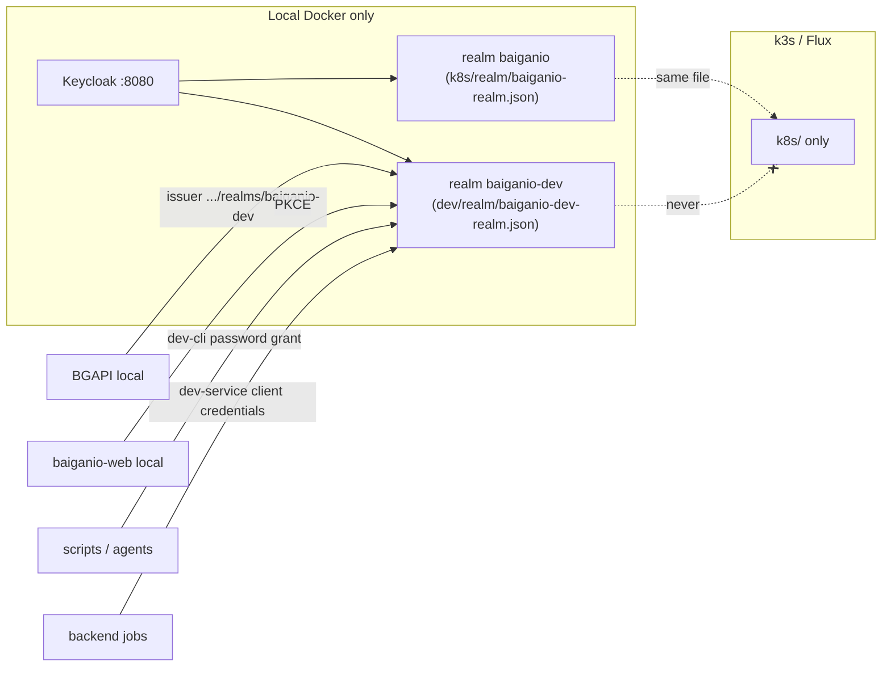

# Plan: local throwaway dev realm

## Objective

Give developers a local-only `baiganio-dev` realm with known test users and
clients, so apps (BGAPI, baiganio.github.io, others) can test login and roles
without touching the real `baiganio` realm.

## Diagram

## Model recommendation

Sonnet. About 40k input / 8k output tokens, well under $1. Routine JSON,
compose, and shell work; no trust change to deployed environments.

## Steps

1. Add `dev/realm/baiganio-dev-realm.json` outside `k8s/`, same client IDs and
   roles as the real realm, plus `dev-cli`, `dev-service`, `dev-spa`, and one
   user per test case. No `${...}` placeholders, so the reset script can
   import it with `kcadm`.
   Works when: `python3 -m json.tool` parses it.
2. Mount it in `docker-compose.yml` next to the real realm file.
   Works when: `docker compose config` is valid and `k8s/kustomization.yaml`
   is unchanged.
3. Add `scripts/reset-dev-realm.sh` (delete + recreate the dev realm only).
   Works when: running it twice gives the same realm and `baiganio` is untouched.
4. Smoke test.
   Works when: issuer is `http://localhost:8080/realms/baiganio-dev`;
   `dev-cli` password grant returns a token with `aud` = `bgapi-api` and the
   right role; `dev-service` client-credentials grant returns a token;
   `dev-disabled` is refused; real clients still refuse password grant.
5. Write `DEV_REALM.md` team note (after developer confirms).

## Risks

| Risk | Mitigation |
|---|---|
| Dev realm drifts from the real realm | Same client IDs/roles; note in `DEV_REALM.md` to update both together. |
| Known passwords leak to a server | File lives outside `k8s/`; Flux/Kustomize never sees it; note says local only. |
| Reset script hits the real realm | Script hard-codes realm `baiganio-dev` and refuses anything else. |

## Doc updates

- New `DEV_REALM.md` (team note).
- `DOCKER.md` — mention second realm and reset script.
- `README.md` — repo contents table (`dev/`, `scripts/reset-dev-realm.sh`).
- `AGENTS.md` — one line in Reference Files.
